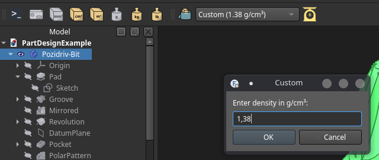

## Estimate Workbench 

A FreeCAD workbench to estimate material quantity by volume or weight for selected parts

You can display the volume or expected weight of selected objects at the push of a button. Both display with the decimal precision as set in FreeCAD's settings (2 by default if not specified). Rounding has been adjusted to ignore floating point offsets and limit confusion with defined 1cm³ cubes displaying 1.01 cm³. This might lead to a slight but most likely negligible rounding error, as the output enables you to estimate or calculate the necessary amount of material for additive manufacturing - @100 % infill, ignoring support structures, purging and other slicer settings that add anyway.

Common 3d-printing materials and a range of metals are supported by default, and you can always pick a custom density in g/cm³ from the same material dropdown.

### Usage

Select objects, parts, groups or bodies and at the push of a button of the workbench the desired output is displayed in the report view panel or as a popup.

Two toolbars are available:

**Settings**
* Select the desired report mode for report view or popup
* Select the desired output for the volume in mm³, cm³ or m³
* Select the desired output for the weight in g, kg or lb 

**Estimate**
* The volume button returns the volume of the selected objects
* The material dropdown selects what the weight is calculated with
    * 3d-printing plastics: ABS, NYLon, PA12, PolyCarbonate, PETG, PLA and TPU
    * metals: aluminium, brass, bronze, copper, gold, iron, lead, magnesium, mercury, nickel, platinum, silver, steel, tin alloys, titanium, tungsten and zinc
    * *Custom…* at the end of the list asks for a decimal density in g/cm³ (comma or dot), saves it and shows it in the dropdown, e.g. *Custom (1.38 g/cm³)*. Pick it again to change the density. The saved density is kept across FreeCAD restarts
* The calculate button (scale icon) next to the dropdown returns the estimated weight of the selected objects for the picked material. If the report view panel is closed it is opened, so the result isn't missed

Thats all. Basically the workbench reads the objects shape.volume-property provided by FreeCAD, which is conveniently returned in mm³.

### Bug/Feedback

Please report bugs to the [issue queue](https://github.com/erroronline1/estimateWB/issues) and ping the [dedicated estimateWB FreeCAD forum thread](https://forum.freecad.org/viewtopic.php?f=22&t=67078) to discuss said issue or feedback in general.   