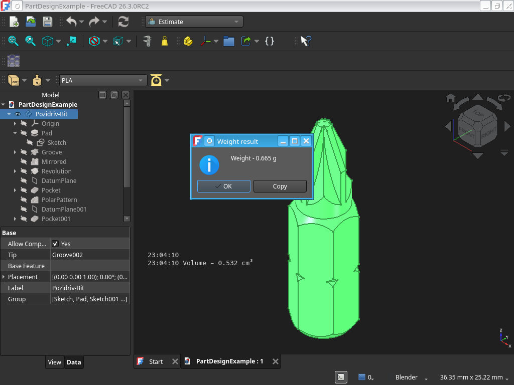
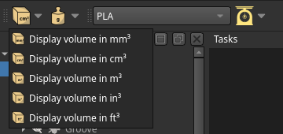
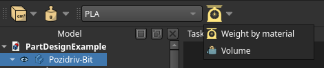
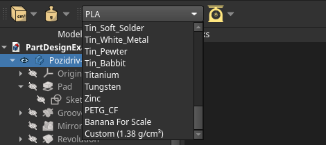
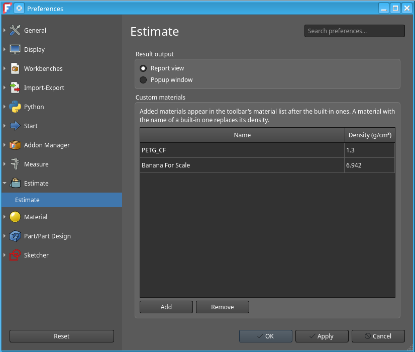

## Estimate Workbench 

A FreeCAD workbench to estimate material quantity by volume or weight for selected parts

You can display the volume or expected weight of selected objects at the push of a button. Both display with the decimal precision as set in FreeCAD's settings (2 by default if not specified), results below 1 keep at least 3 significant digits so small parts don't show as 0.00 in large units like m³ or ft³. Rounding is to the nearest value, so a defined 1cm³ cube displays 1.00 cm³ and not 1.01 cm³ due to floating point offsets. The output enables you to estimate or calculate the necessary amount of material for additive manufacturing - @100 % infill, ignoring support structures, purging and other slicer settings that add anyway.

Common 3d-printing materials and a range of metals are supported by default, you can add your own materials in the preferences, and you can always pick a one-off custom density in g/cm³ from the same material dropdown.

### Usage

Select objects, parts, groups or bodies and at the push of a button of the workbench the desired output is displayed in the report view panel or as a popup, e.g. *Volume - 0.532 cm³* or *Weight - 0.665 g*.

Two toolbars are available:

**Estimate Settings**
* The volume unit button sets the output for the volume in mm³, cm³, m³, in³ or ft³
* The weight unit button sets the output for the weight in g, kg, lb or oz
* Both buttons show the unit in use, the arrow next to them lists the others. The *Estimate Settings* menu lists all units as well

**Estimate**
* The material dropdown selects what the weight is calculated with, showing 10 entries at a time
    * 3d-printing plastics: ABS, NYLon, PA12, PolyCarbonate, PETG, PLA and TPU
    * metals: aluminium, brass, bronze, copper, gold, iron, lead, magnesium, mercury, nickel, platinum, silver, steel, tin alloys, titanium, tungsten and zinc
    * your own materials from the [preferences](#preferences)
    * *Custom…* at the end of the list asks for a decimal density in g/cm³ (comma or dot), saves it and shows it in the dropdown, e.g. *Custom (1.38 g/cm³)*. Pick it again to change the density. The saved density is kept across FreeCAD restarts
* The calculate button (scale icon) next to the dropdown returns the estimated weight of the selected objects for the picked material. The arrow next to it switches between *Weight by material* and *Volume*, the button keeps the last used one. If the report view panel is hidden it is brought to the front, so the result isn't missed

### Preferences

*Edit → Preferences → Estimate* holds the workbench settings:
* **Result output**: show results in the report view or as a popup with a copy button
* **Custom materials**: add materials with a name and a density in g/cm³, they are listed in the material dropdown after the built-in ones. A material with the name of a built-in one replaces its density. Changes apply to the dropdown right away

Thats all. Basically the workbench reads the objects shape.volume-property provided by FreeCAD, which is conveniently returned in mm³.

### Bug/Feedback

Please report bugs to the [issue queue](https://github.com/erroronline1/estimateWB/issues) and ping the [dedicated estimateWB FreeCAD forum thread](https://forum.freecad.org/viewtopic.php?f=22&t=67078) to discuss said issue or feedback in general.   