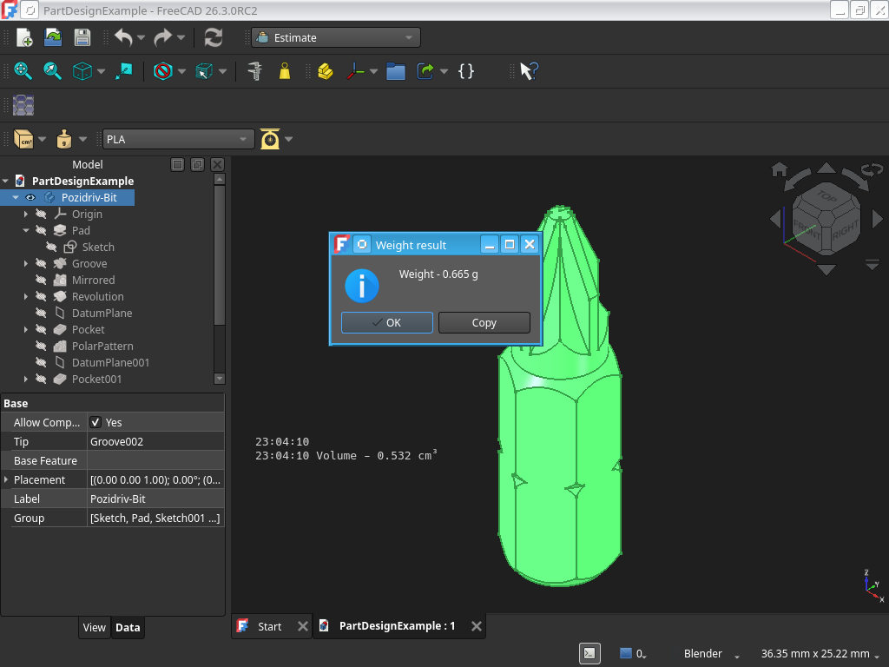
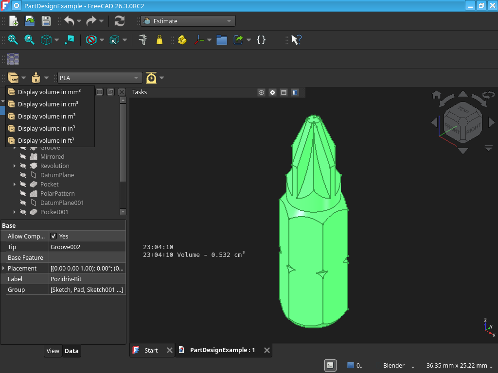
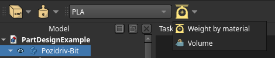
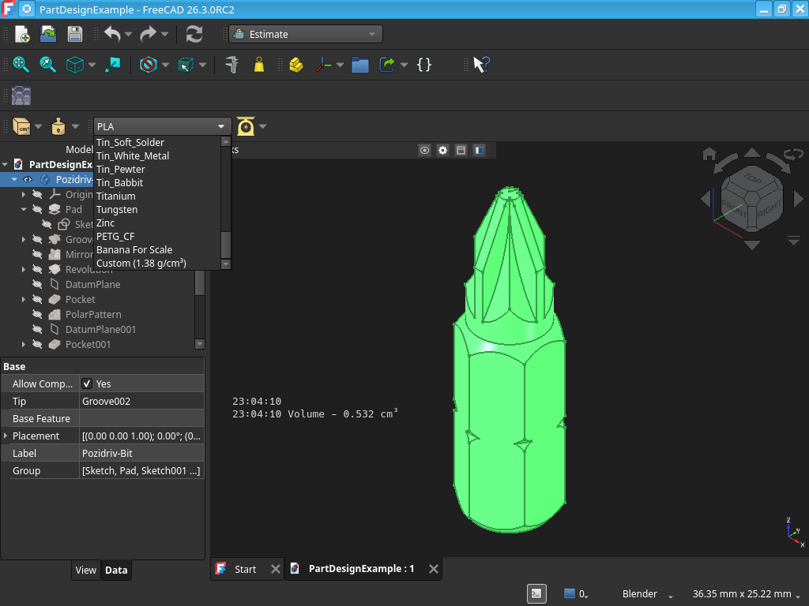
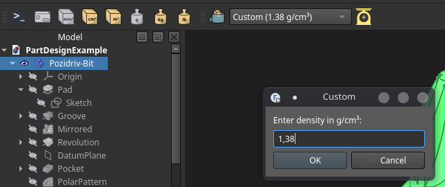
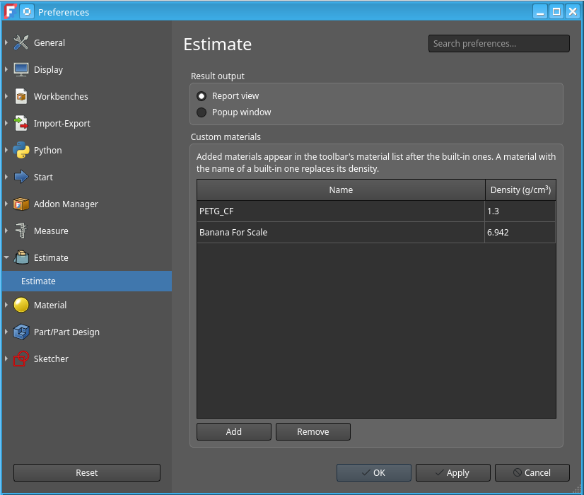

## Estimate Workbench 

A FreeCAD workbench to estimate material quantity by volume or weight for selected parts

> **This is a fork.** The Estimate workbench is the work of [error on line 1](https://github.com/erroronline1) - the original lives at [erroronline1/estimateWB](https://github.com/erroronline1/estimateWB) and is available in FreeCAD's Addon Manager as-is. All credit for the workbench goes to them and its contributors [@zackwhit](https://github.com/zackwhit), [@PhoneDroid](https://github.com/PhoneDroid), [@chennes](https://github.com/chennes) and [@luzpaz](https://github.com/luzpaz). Since November 2026 this fork's [`custom` branch](https://github.com/i-machine-things/estimateWB/tree/custom) has modified it: it reworks the toolbar and adds preferences, units and materials, see [*unreleased*](#version-update) for what changed and [Installation](#installation) for how to install it.

### Background
[This frankenstein's monster of a workbench](#about-the-code) for FreeCAD has been somehow sewn together to work almost as expected.

You can display the volume or expected weight of selected objects at the push of a button. Both display with the decimal precision as set in FreeCAD's settings (2 by default if not specified), results below 1 keep at least 3 significant digits so small parts don't show as 0.00 in large units like m³ or ft³. Rounding is to the nearest value, so a defined 1cm³ cube displays 1.00 cm³ and not 1.01 cm³ due to floating point offsets. The output enables you to estimate or calculate the necessary amount of material for additive manufacturing - @100 % infill, ignoring support structures, purging and other slicer settings that add anyway.

Common 3d-printing materials and a range of metals are supported by default, you can add your own materials in the preferences, and you can always pick a one-off custom density in g/cm³ from the same material dropdown.


*The Pozidriv bit from FreeCAD's PartDesign example, selected with PLA picked: the volume shows in the report view, the weight in a popup with a copy button. The toolbar on the left holds the unit buttons, the material dropdown and the calculate button.*

### Version compatibility

<details>
<summary>Confirmed with FreeCAD 26.3rc2 and 1.1.4 - Expand for more</summary>

Tested with the current toolbar, preferences and units:
* 26.3rc2 (Linux, Qt 6.11, Python 3.13) - all features
* 1.1.4 (Linux Flatpak) - weight and volume results

Confirmed for 0.1.5, not yet tested since the toolbar rework:
* 1.1rc build 40041 x86_64
* 1.0
* 0.21.2
* 0.19

The code avoids Python 3.9+ features and has a fallback for Qt5, so these older versions are expected to work. Reports either way are welcome in [this fork's issue queue](https://github.com/i-machine-things/estimateWB/issues).

</details>

### Version update
* unreleased
    * **material dropdown instead of one button per material**: the estimate toolbar had a button for every material, which doesn't scale beyond a handful of materials. Materials are now picked from a dropdown, limited to 10 visible entries with a scrollbar
    * **one calculate button for weight and volume**: weight and volume share a single toolbar button with a dropdown arrow, like FreeCAD's own grouped commands, placed after the material dropdown
    * **metals added**: aluminium, brass, bronze, copper, gold, iron, lead, magnesium, mercury, nickel, platinum, silver, steel, tin alloys, titanium, tungsten and zinc densities. These were stranded in an outdated copy of the workbench in the repository root since the restructure and are now part of the actual workbench
    * **custom density moved into the dropdown**: the separate custom density button is replaced by the *Custom…* entry, which prompts once, remembers the density across restarts and is used by the calculate button like any other material
    * **preferences page**: report view / popup output moved from the toolbar to *Edit → Preferences → Estimate*, which also lets you add your own materials
    * **unit buttons**: the six unit buttons are two dropdown buttons, one for volume and one for weight, each showing the unit in use
    * **more units**: in³ and ft³ for volume, oz for weight
    * **result format**: results read *Weight - 0.665 g* and *Volume - 0.532 cm³* in the report view and popup, as the material is visible in the dropdown
    * **rounding**: results below 1 keep at least 3 significant digits instead of turning into 0.00 in large units, and rounding no longer trips over binary floating point (2.675 now rounds to 2.68)
    * **report view raised on calculate**: the report view panel is brought to the front if it's hidden or behind another tab
    * **older Python**: the workbench loads on Python 3.8 again, which FreeCAD 0.19 and many 0.21 builds ship (newer-only type hints and resource loading are replaced)
    * **cleanup**: the outdated root level copy of the workbench (pre-restructure python files, languages and icons) and the no longer used per-material, custom density and output toggle icons are removed
* 0.1.5
    * same functionality, new codebase
    * settings as a single menu item and toolbar
    * storing last selected preferences
    * a lot of comments within the code for newcomers and future reference 

### Usage

Select objects, parts, groups or bodies and at the push of a button of the workbench the desired output is displayed in the report view panel or as a popup, e.g. *Volume - 0.532 cm³* or *Weight - 0.665 g*.

Two toolbars are available:

**Estimate Settings**
* The volume unit button sets the output for the volume in mm³, cm³, m³, in³ or ft³
* The weight unit button sets the output for the weight in g, kg, lb or oz
* Both buttons show the unit in use, the arrow next to them lists the others. The *Estimate Settings* menu lists all units as well


*The volume unit button's menu, top left. The weight unit button next to it works the same way.*

**Estimate**
* The material dropdown selects what the weight is calculated with, showing 10 entries at a time
    * 3d-printing plastics: ABS, NYLon, PA12, PolyCarbonate, PETG, PLA and TPU
    * metals: aluminium, brass, bronze, copper, gold, iron, lead, magnesium, mercury, nickel, platinum, silver, steel, tin alloys, titanium, tungsten and zinc
    * your own materials from the [preferences](#preferences)
    * *Custom…* at the end of the list asks for a decimal density in g/cm³ (comma or dot), saves it and shows it in the dropdown, e.g. *Custom (1.38 g/cm³)*. Pick it again to change the density. The saved density is kept across FreeCAD restarts
* The calculate button (scale icon) next to the dropdown returns the estimated weight of the selected objects for the picked material. The arrow next to it switches between *Weight by material* and *Volume*, the button keeps the last used one. If the report view panel is hidden it is brought to the front, so the result isn't missed


*The arrow next to the calculate button switches between weight and volume.*


*The end of the material dropdown: the last built-in metals, two custom materials from the preferences and the saved custom density.*


*Picking Custom… asks for a density; the dropdown then shows it, here Custom (1.38 g/cm³).*

### Preferences

*Edit → Preferences → Estimate* holds the workbench settings:
* **Result output**: show results in the report view or as a popup with a copy button
* **Custom materials**: add materials with a name and a density in g/cm³, they are listed in the material dropdown after the built-in ones. A material with the name of a built-in one replaces its density. Changes apply to the dropdown right away


*Edit → Preferences → Estimate with the result output choice and two custom materials.*

Thats all. Basically the workbench reads the objects shape.volume-property provided by FreeCAD, which is conveniently returned in mm³. So any output will be in metric units by default, lb and weight units toolbar work of [@zackwhit](https://github.com/zackwhit/). They also added a popup that has been applied to the volume as well in version 0.1.4 - now selectable for either report view or popup in the preferences.

[@PhoneDroid](https://github.com/PhoneDroid) added the result for *all selected* parts, [@chennes](https://github.com/chennes) contributed packaging and encoding fixes, [@luzpaz](https://github.com/luzpaz) tidied up typos and the readme.

### Installation 

This fork is installed from its `custom` branch. If the original Estimate workbench is installed, uninstall it first: both install into the same `estimateWB` folder and Python package.

#### Addon Manager with a custom repository (recommended)

1. Open *Edit → Preferences → Addon Manager*
2. Under *Custom repositories* click the add button next to the list and enter
    * Repository URL: `https://github.com/i-machine-things/estimateWB`
    * Branch: `custom`
3. Click *OK* to close the preferences
4. Open *Tools → Addon manager*, refresh the list if the workbench doesn't show up yet, select **estimateWB** and click *Install*
5. Restart FreeCAD

Updates then come through the Addon Manager like for any other addon.

<details>
<summary>FreeCAD 0.19 / 0.20</summary>

Older versions set custom repositories in *Tools → Addon manager → Configure...* (not verified for this fork): add a line `https://github.com/i-machine-things/estimateWB custom` (URL, a space, then the branch) to the *Custom repositories* box, close the dialog and restart the Addon Manager.

</details>

#### Manual Installation

<details>
<summary>Expand for directions to manually install this workbench</summary>

Clone the `custom` branch into the personal FreeCAD `Mod` folder, e.g.

```
git clone --branch custom https://github.com/i-machine-things/estimateWB.git estimateWB
```

or download [the branch as a zip](https://github.com/i-machine-things/estimateWB/archive/refs/heads/custom.zip) and unpack it there as a folder named `estimateWB`. The `Mod` folder is

- for Linux `~/.local/share/FreeCAD/Mod/` or `~/.var/app/org.freecad.FreeCAD/data/FreeCAD/Mod`
- for Windows `%APPDATA%\FreeCAD\Mod\` or `C:\Users\username\Appdata\Roaming\FreeCAD\Mod\`
- for Windows as portable app `wherever_stored\FreeCADPortable\Data\FreeCADAppData\Mod`
- for macOS `~/Library/Preferences/FreeCAD/Mod/`

FreeCAD 1.1 and newer keep a folder per version, so `Mod` sits one level deeper there, e.g. `~/.local/share/FreeCAD/v1-1/Mod/`. *Help → About FreeCAD → Copy to clipboard* shows the exact user data folder.

</details>

### Customize

Your own materials are best added in *Edit → Preferences → Estimate*, they survive workbench updates. If you want to change the built-in materials you can edit the `freecad/estimateWB/resources/materials.json`-file (name and density in g/cm³), the material dropdown updates itself after a FreeCAD restart, no icons needed. For a one-off density use the *Custom…* entry.

Different languages according to user settings are technically supported - but actually restricted to english by default and german due to my own limitations. This might be more proof-of-concept than actually useful but feel free to contribute :) Since one does usually not switch languages by the minute I did not bother finding out how to update during runtime yet, so FreeCad has to be restarted to have language-changes take effect on this workbench.

### Bug/Feedback

Please report bugs and feedback for this fork in [its issue queue](https://github.com/i-machine-things/estimateWB/issues). The original workbench's issue queue and forum thread are for the original only, so please don't take problems with this fork there.   

### About the code
Base of everything has been
* [freecad.workbench_starterkit](https://github.com/FreeCAD/freecad.workbench_starterkit/tree/master/freecad/workbench_starterkit) and
* [gears workbench](https://github.com/looooo/freecad.gears/tree/master/freecad/gears)

[Phonedroid](https://github.com/PhoneDroid) reached out to me in 9/25 if I would still be interested in keeping this workbench maintained. Since then I refactored the code as an attempt to declutter everything a bit. Also they stated the workbench_starterkit might be out of date. I followed the kind recommendations and tried to leave as much comments as reasonable in the code for anyone else to have a decent start for their own workbench:
* the folder structure is valid (root and /freecad/{workbench name})
* the BaseCommand supports multiple parameters for function calls
* you'll need basically only the
    * package.xml,
    * \_\_init__.py and
    * init_gui.py
* pyproject.toml is not mandatory but the way to go if you are in need to define dependent modules not part of the default python libraries
* the distribution of other files as well as the language model are just a decision, versionupdate.py is not more than a tiny helper tool you can easily omit. as far as i understand everything *could* go into the init_gui.py only.

## License

Copyright (C) 2022-2025 error on line 1 and contributors\
Modifications on the `custom` branch Copyright (C) 2026 i-machine-things

estimateWB is free software: you can redistribute it and/or modify it under the terms of the GNU Lesser General Public License as published by the Free Software Foundation, either version 3 of the License, or (at your option) any later version. See [LICENSE.txt](LICENSE.txt) for the LGPL and [COPYING](COPYING) for the GNU General Public License it builds on.

This fork has been modified from the original since November 2026, the changes are listed under [*unreleased*](#version-update) and in the git history.
